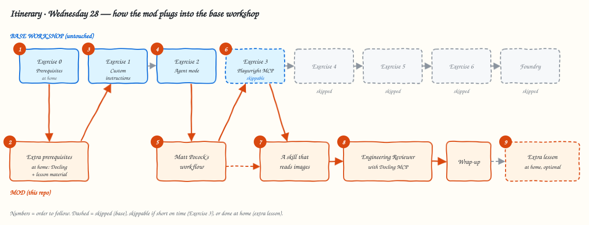
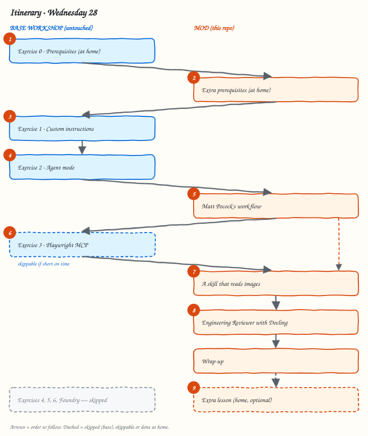

This is **a mod of the Dev Days workshop**. You follow the [base workshop][base] as it is, the VS Code track of *Real-world development* with Tailspin Toys, and at set points you switch to the lessons published here. Along the way you adopt Matt Pocock's workflow and build the **Engineering Reviewer**: a custom agent that reads the requirements PDF, a scanned meeting minutes document, the architecture diagram and the code, and tells you where they disagree.

> [!IMPORTANT]
> **You need GitHub Copilot to do this workshop**: a GitHub account with **Copilot Student** (free for verified students), **Pro**, **Pro+**, **Business** or **Enterprise**. Copilot Free is not enough. See the *[Extra prerequisites](prerequisites/#copilot-plan-and-model)*.

The base lessons stay on the base site, in English. The mod lessons, its extra prerequisites and its material live in this repo, also in English. You can talk to the agent in Spanish.

## Itinerary

1. [Exercise 0 · Prerequisites][ex0] (base, **at home before the workshop**)
2. [Extra prerequisites](prerequisites/) (mod, **at home before the workshop**)
3. [Exercise 1 · Custom instructions][ex1] (base)
4. [Exercise 2 · Agent mode][ex2] (base)
5. [Matt Pocock's workflow](pocock-workflow/) (mod)
6. [Exercise 3 · Testing your feature with the Playwright MCP server][ex3] (base, **skippable** if short on time)
7. [A skill that reads images](image-skill/) (mod)
8. [The Engineering Reviewer with Docling MCP](engineering-reviewer/) (mod)
9. [Extra: orchestration in code](extra-orchestration/) (mod, at home, optional)

The itinerary skips the rest of the base workshop (Exercises 4–6 and Foundry): the mod lessons replace them. Whatever you don't finish in the session, you can finish at home.

## Rehearsed base

The mod was rehearsed against these commits of the base:

- Lessons: [`github-samples/copilot-workshops@35c69f6`](https://github.com/github-samples/copilot-workshops/tree/35c69f6)
- Template: [`github-samples/tailspin-toys@a0f74a8`](https://github.com/github-samples/tailspin-toys/tree/a0f74a8)

If the base has changed since, compare against them.

[base]: https://github-samples.github.io/copilot-workshops/real-world-development/vscode/
[ex0]: https://github-samples.github.io/copilot-workshops/real-world-development/vscode/0-prerequisites/
[ex1]: https://github-samples.github.io/copilot-workshops/real-world-development/vscode/1-custom-instructions/
[ex2]: https://github-samples.github.io/copilot-workshops/real-world-development/vscode/2-agent-mode/
[ex3]: https://github-samples.github.io/copilot-workshops/real-world-development/vscode/3-mcp/
